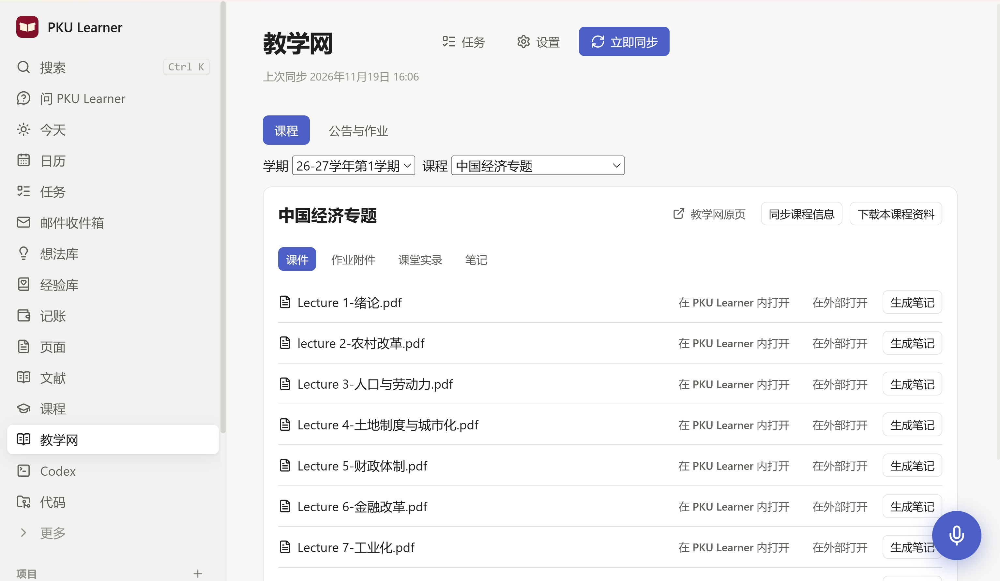
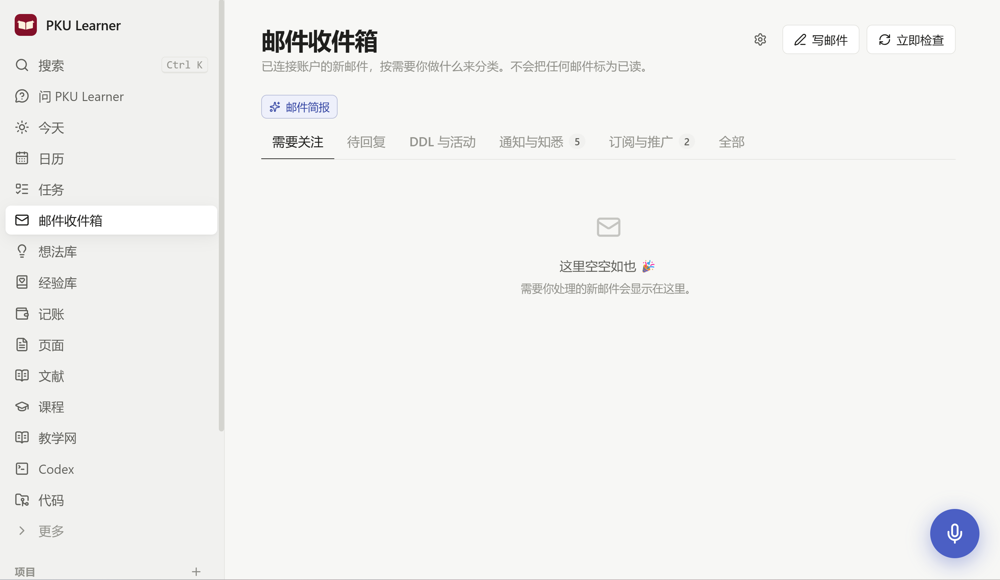

# PKU Learner

PKU Learner 是由 oceanlby 维护的北大课程学习助手。同步**北大教学网**的课件、作业和公告，把课堂实录整理成可复习的笔记，也可以在同一个应用里处理邮件、日历、待办和论文。

[官网下载](https://oceanlby.github.io/pku-learner/#download) · [发布记录](https://github.com/oceanlby/pku-learner/releases)

## 界面预览

在「教学网」按学期和课程查看资料。选中一份 PDF，可直接在应用内打开或生成笔记。

查看「今天」、日历和邮件收件箱

| 今天 | 日历 | 邮件收件箱 |
| --- | --- | --- |
|  |  |  |

## 北大教学网

- **同步课件和作业**。课件先查「教学内容」，再查「课程讲义」，也能匹配教师自定义栏目。默认自动下载当前学期的附件，往期资料可手动同步。
- **把回放和课件整理成笔记**。回放按需下载，结合硅基流动语音转写、本机识别的关键画面和相关 PDF，生成独立的 Markdown 笔记，再更新课程总笔记。可使用内置模板或导入自己的模板。
- **在应用内读课件和笔记**。直接打开 PDF 和 Markdown，支持选中文字向 AI 提问。实录笔记可选择同时参考本节语音转写，按时间段追溯课堂原话。
- **把考试和截止时间加进日历**。摘要课程公告和作业要求，提取候选时间。你可以逐项确认后加入日历，也可将看过的通知归档或忽略。

每门课按 `课件`、`作业`、`笔记`、`视频` 归档。带时间段的语音转写单独保存为 Markdown。启用视频保留选项后，回放存入该课程的 `视频` 目录。

## 其他功能

用页面写笔记、记录灵感和管理项目。用邮件收件箱提取待办、会议和截止日期，用日历安排课程与个人时间。论文库支持 PDF 阅读、翻译和文献检索，桌面版也提供终端、Git 和 Codex 会话入口。

## 安装和使用

从 0.6.11 起，Windows x64、macOS（Apple 芯片和 Intel）及 Linux x64 均支持教学网。Linux 需启用并解锁系统密钥环来保存登录信息。

1. 在[下载页](https://oceanlby.github.io/pku-learner/#download)选择对应平台的 EXE、DMG 或 AppImage。
2. 在「设置 → 教学网」登录自己的校园卡账号并选择资料保存位置。
3. 在「设置 → AI 模型」配置硅基流动中国站和 DeepSeek 官方 API Key。回放音频按段发送到硅基流动，教学网文本功能使用官方 DeepSeek Flash，扫描课件和视频关键画面在本机识别。
