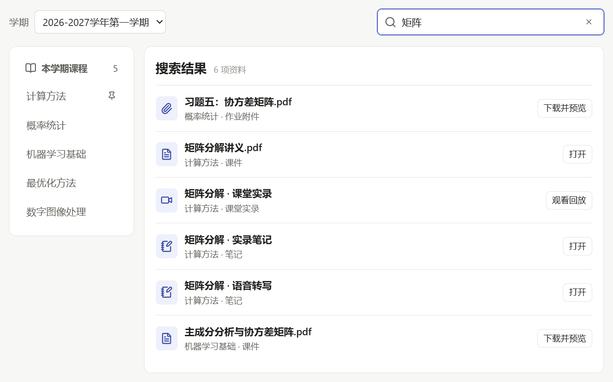
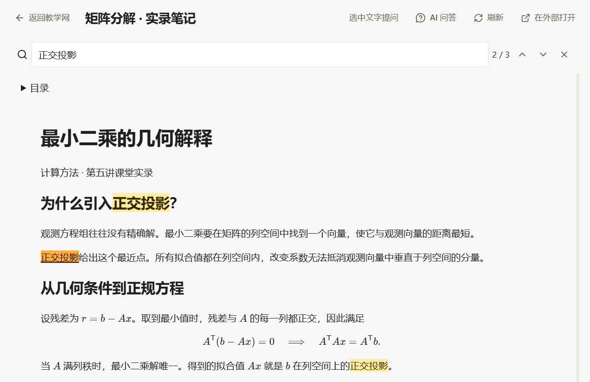
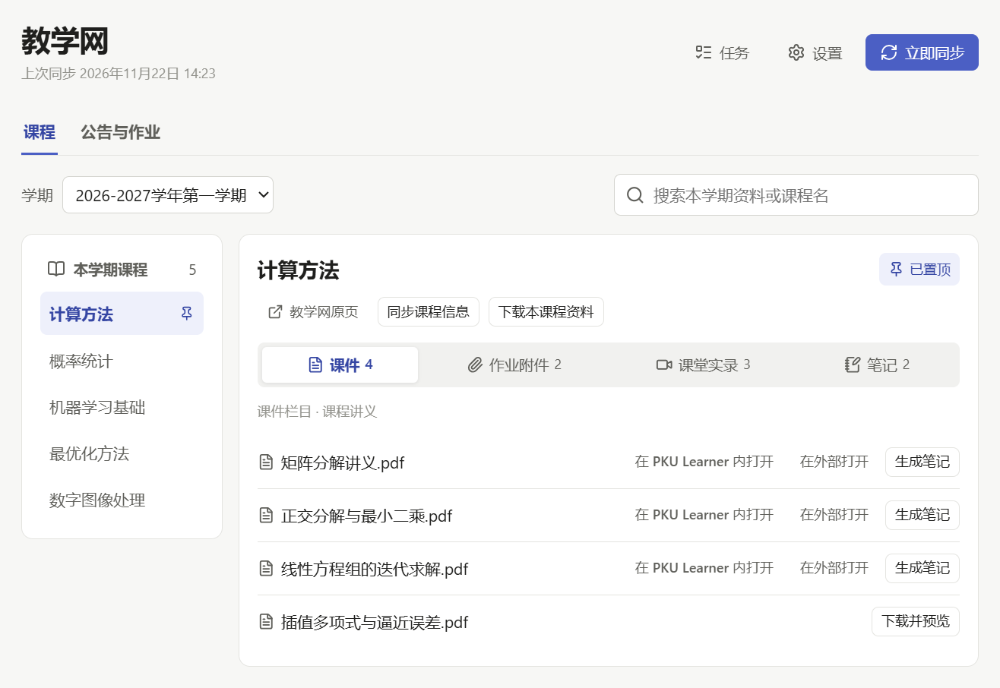
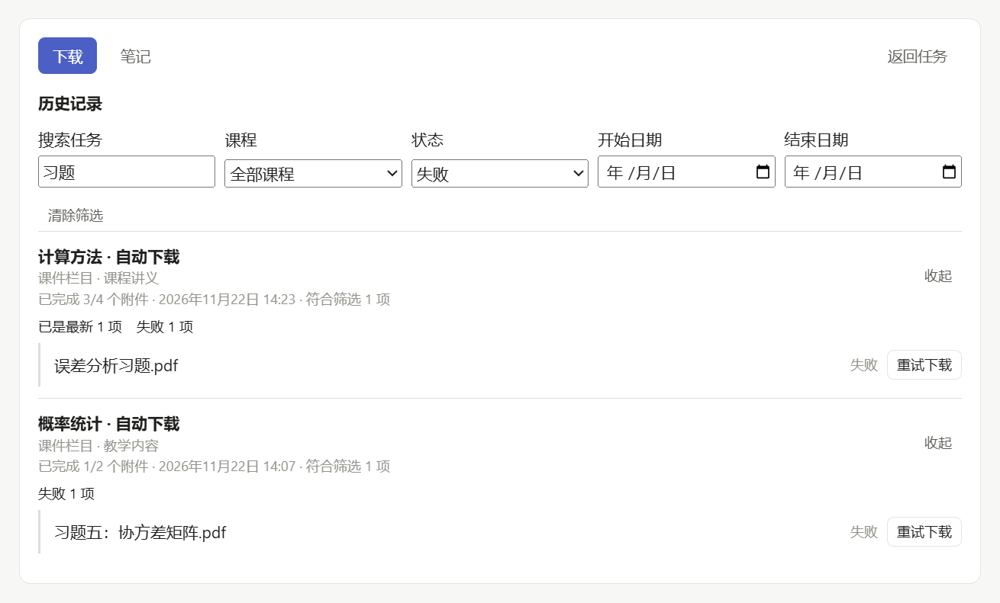
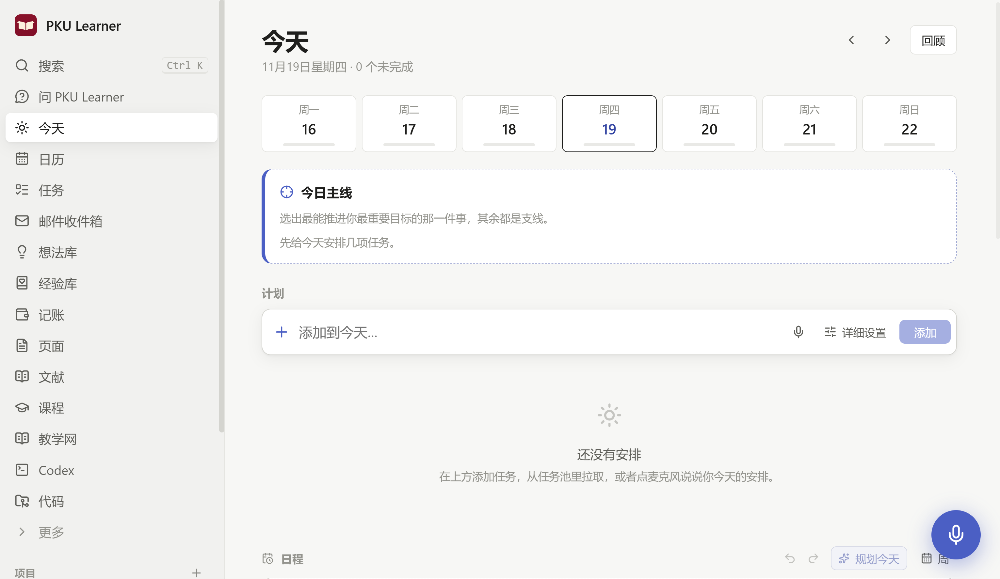
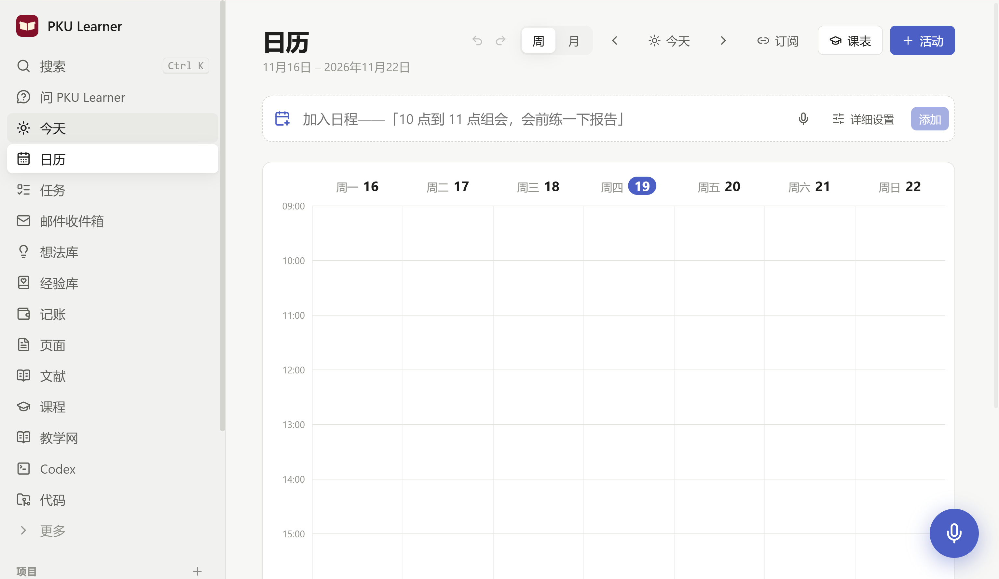

# PKU Learner

**北大课程学习助手 · 永久免费**　支持 Windows、macOS 和 Linux。

期末复习，只记得老师讲过「矩阵分解」，想不起是哪一讲？在 PKU Learner 里搜「矩阵」，这学期不同课程的讲义、习题、回放和笔记会列在一起。点开讲义读原文，或到课堂转写里找到老师讲这段话的时间。

[下载桌面版](https://oceanlby.github.io/pku-learner/#download) · [查看 0.7.4 更新](https://github.com/oceanlby/pku-learner/releases/tag/v0.7.4)

**软件永久免费。** 同步课程、下载资料、搜索和本地阅读都可以直接使用。需要 AI 转写、整理笔记或问答时，填写自己的 API Key，用量和费用按相应服务商的规则计算。

## 一个词，找到散在几门课里的资料

选择学期，输入文件名、课程名或几个关键词。搜索覆盖课件、作业附件、课堂实录和笔记。你可以从结果直接打开 PDF、观看回放或下载附件，从阅读器返回后接着查看刚才的结果。

## 从一节课的笔记，查回老师的原话

选一份 PDF 或一节回放，生成一篇独立的 Markdown 笔记，也可以把内容整理进课程总笔记。回放语音会单独保存为带时间段的转写稿。读到想核对的地方，用 `Ctrl/Cmd+F` 查找正文，按 `Enter` 跳到下一处。提问时勾选「同时参考本节语音转写」，可以从回答的引用跳回相应片段。

## 上课前找讲义，下课后查进度

| 把常用课放在手边 | 找回一次下载或笔记任务 |
| --- | --- |
| 置顶常用课程，切课时直接看到课件、作业附件、回放和笔记各有多少。当前学期的附件可自动下载，往期课程可手动同步。 | 在任务历史里输入课程名或资料标题，再按状态、日期筛选。自动下载批次会展开到匹配的附件，失败项可直接重试。 |
|  |  |

资料保存在你选择的文件夹。每门课下分 `课件`、`作业`、`笔记`、`视频`，转写稿和整理后的笔记都能用常用的 Markdown 编辑器打开。教学网公告里的考试安排和作业截止时间，可以在确认后加入日历。

## 第一次使用

1. 从官网下载页选择安装包。Windows 选 x64 EXE。Mac 按芯片选择 Apple 芯片或 Intel 版 DMG。Linux x64 选 AppImage。[官网下载](https://oceanlby.github.io/pku-learner/#download)
2. 打开「设置 → 教学网」，用自己的校园卡账号登录。
3. 选择资料保存文件夹，在「教学网」点击「立即同步」。
4. 如需 AI 功能，在「设置 → AI 模型」填写对应服务的 Key。回放语音转写用硅基流动中国站，教学网的笔记整理、资料问答和公告摘要用 DeepSeek 官方 API。

## 资料与隐私

教学网登录信息经系统安全存储加密保存，Linux 需要启用并解锁系统密钥环。PDF 文字、扫描页和回放关键画面在本机提取。使用语音转写时，音频分段发送给硅基流动。使用 AI 整理或问答时，相关文本发送给所配置的模型服务。

Windows 安装包未经代码签名，macOS 安装包未经 Apple 公证，首次打开时系统可能显示提示。安装后可在应用内检查更新，下载的更新包会经过 SHA-256 校验。

查看日历、邮件和其他学习工具

用日历安排课表和截止时间，从收件箱整理邮件待办，或用论文库阅读 PDF、翻译段落和检索文献。应用还提供日常笔记、项目管理，以及终端、Git 和 Codex 会话入口。

| 今天 | 日历 | 邮件 |
| --- | --- | --- |
|  |  |  |

